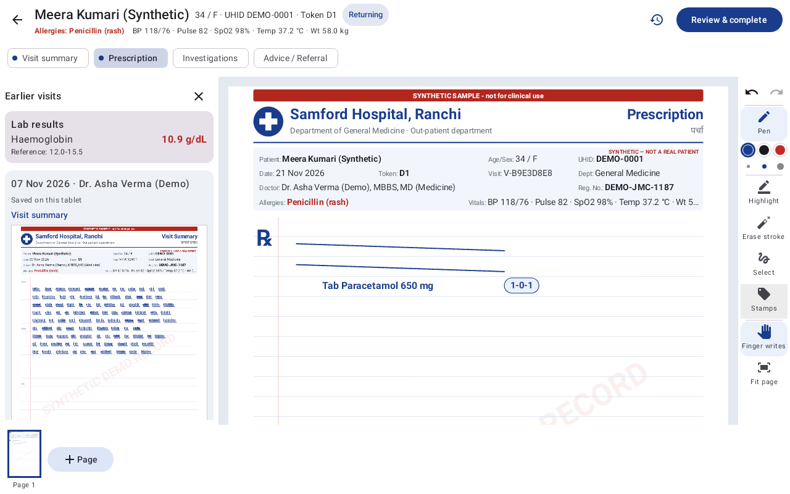
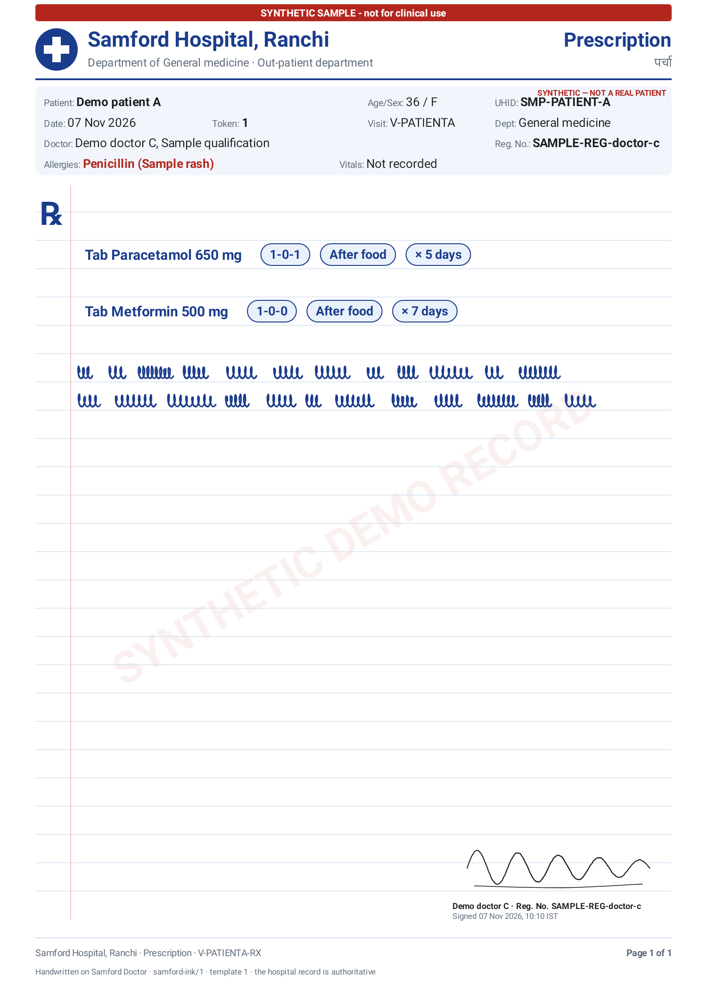
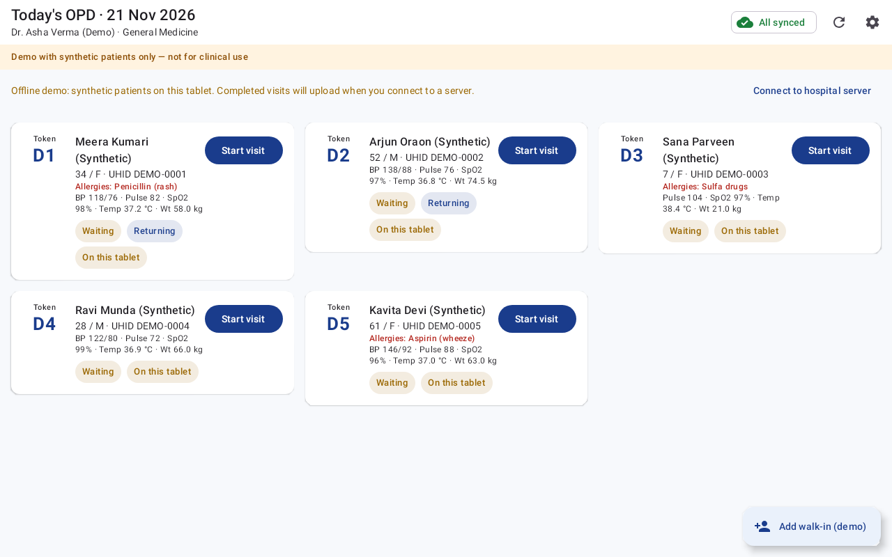
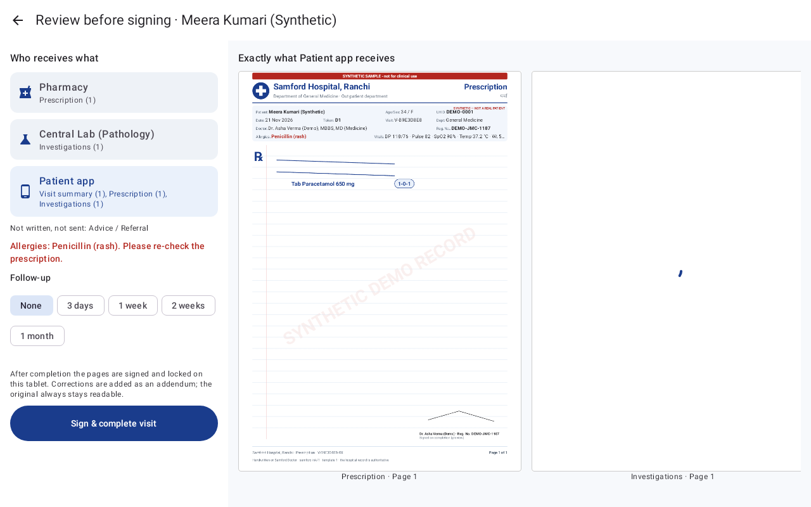
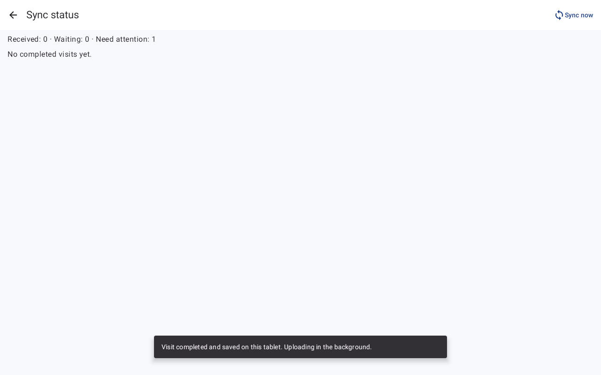
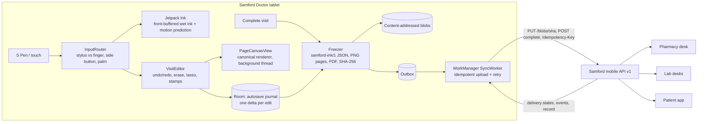

# Samford Doctor — paperless OPD on a tablet

Android app for doctors at Samford Hospital, Ranchi (a **demo with synthetic data only**). The doctor
writes the visit by hand on a Samsung Galaxy Tab with the S Pen, exactly like an OPD pad. When the
visit is completed the handwriting is signed, frozen and synced, and the **same pages** reach the
pharmacy, the chosen labs and the patient's app. Returning patients' earlier handwritten pages and
lab results open side by side while writing.

- Companion patient app: [shivam098/samford-patient-android](https://github.com/shivam098/samford-patient-android)
- Mock hospital backend + pharmacy/lab desks: [shivam098/samford-web-app](https://github.com/shivam098/samford-web-app) (mobile API v1)
- Live web desks (synthetic shared demo): https://shivam098.github.io/samford/ — after choosing a persona: [front-desk check-in](https://shivam098.github.io/samford/#journey/SJ04), [pharmacy](https://shivam098.github.io/samford/#journey/SJ10), [lab](https://shivam098.github.io/samford/#journey/SJ14)

> Synthetic sample: every page carries a red "SYNTHETIC SAMPLE - not for clinical use" banner. Do not enter real patient data.

| Writing (split view with the earlier visit) | What recipients receive (canonical page) |
|---|---|
|  |  |

| Today's queue | Review: who receives what | Sync status |
|---|---|---|
|  |  |  |

More screenshots (generated by the automated UI test, reviewed by eye): [docs/screenshots](docs/screenshots).

## Install the test APK

1. Download `samford-doctor-v0.1.0.apk` from the [v0.1.0 release](https://github.com/shivam098/samford-doctor-android/releases/tag/v0.1.0) and check its SHA-256 against the value in the release notes (`Get-FileHash` on Windows, `sha256sum` on Linux/macOS).
2. On the Samsung tablet open the APK from **My Files** (or the browser's downloads).
3. When Android blocks it, tap **Settings** and allow **Install unknown apps** for that app (Samsung: *Settings → Apps → ⋮ → Special access → Install unknown apps → My Files/Chrome → Allow*). Go back and tap **Install**.
4. Requires Android 13 or later. Designed for Galaxy Tab S-series with S Pen, portrait or landscape; any Android 13+ tablet works (use "Finger writes" without a pen).

The release is signed with the project's demo key; future versions install over it as updates.

## Demo walkthrough (5 minutes)

1. **Sign in** — choose a demo doctor. With a reachable server you get the hospital's personas; without one, the app offers **offline demo** personas with labelled synthetic patients.
2. **Signature** — sign once on the pad. It is applied to every completed document with the time (IST) and registration number.
3. **Queue** — today's check-ins (front desk on the web app) with *Returning* badges, allergies and vitals. Tap a patient and confirm identity. *Add walk-in (demo)* creates a synthetic patient.
4. **Write** — tabs for Visit summary, Prescription, Investigations, Advice/Referral, each with its own pages. The patient header (name, age/sex, UHID, date, token, doctor, qualification, Reg. No., allergies, vitals) is printed automatically on every page.
   - S Pen writes; **hold the side button to erase**; fingers scroll and pinch-zoom; **two-finger tap = undo**.
   - Pen colours (blue/black/red) and widths, highlighter, stroke/area eraser, lasso (move/resize/delete), undo/redo.
   - **Stamps**: dosage chips (1-0-1, SOS…), food timing, durations, advice, favourite medicines and tests, body/chest/abdomen diagrams to annotate. Tap a stamp, then tap the page.
   - Writing near the bottom of the last page adds a page automatically; the page strip shows thumbnails.
   - Returning patient: the **Earlier visits** pane shows previous handwritten pages (tap to enlarge) and lab results; **Repeat this prescription** brings the earlier Rx in as a labelled, editable layer.
   - Investigations: choose the labs that should receive them.
5. **Review & complete** — see exactly what the pharmacy, each lab and the patient will receive (rendered pages, with your signature preview), allergy reminder, optional follow-up. **Sign & complete** freezes the record on the tablet in a second; call the next patient while it uploads.
6. **Sync status** — per visit: Saved on tablet → Uploading → Received by hospital, then per recipient (pharmacy viewed/dispensed, lab sample collected/result ready, patient viewed).
7. **Corrections** — open the record and **Add addendum** with a reason. A new signed version is created; the original stays unchanged and readable everywhere.

Offline: everything above works without a network. Completed visits wait on the tablet ("Saved on tablet") and upload automatically, without duplicates, when the server is reachable and the doctor is signed in.

## Server discovery and override

- The build has a baked-in discovery URL (`samford.discoveryUrl` in `gradle.properties`), a stable JSON published by the backend: `{schema:"samford-endpoint/1", status, apiBaseUrl, ...}`. When `status` is `online`, its `apiBaseUrl` is validated with `GET {apiBaseUrl}/meta`.
- The demo server sits behind a tunnel whose address changes when it restarts. When the server stops answering (no connection, or an error page that isn't the API's), the app marks it unreachable and re-runs discovery on the next queue refresh or sync retry, so it follows the new address without a restart.
- **Returning-patient demo on the live server**: on the web desk sign in as the *desk* persona, book patient-b with doctor-a today (Appointments, SJ03) and check them in (Check-in, SJ04). The tablet then shows patient-b as returning, with doctor-c's earlier handwritten visit and its prescription v1/v2.
- **Manual override** (sign-in screen or Settings): type an address such as `http://192.168.1.20:4320` (the app appends `/api/mobile/v1`).
- **QR / link**: a QR code containing `samford-doctor://connect?api=http://192.168.1.20:4320/api/mobile/v1`, scanned with the Samsung Camera app, opens the app and sets the server.
- The last server that worked is remembered and used when discovery is unavailable.
- Run the backend yourself: in `samford-web-app`, `npm ci && npm run mobile:isolated -- --port 4320 --data <empty dir> --reset --test-support` (see that repo's docs). The emulator reaches the host at `http://10.0.2.2:4320/api/mobile/v1`.

## Architecture



- **Stack**: Kotlin 2.4, Jetpack Compose + Material 3, Jetpack Ink 1.0 (wet ink), androidx.input motion prediction, Room 2.8 (KSP), WorkManager, DataStore, kotlinx.serialization, OkHttp 5, R8 + Baseline Profile. AGP 9.5, Gradle 9.9.2, compileSdk 37, **minSdk 33** (Galaxy Tab S6 and later ship Android 13+; gives per-app language and palm-cancel flags without shims), **targetSdk 36** (API 37's local-network permission would block testers reaching a LAN backend; revisit with public HTTPS).
- Code map: `ink/` record format and geometry · `render/` canonical renderer, templates, PDF · `ui/write/` writing surface · `editor/` editing state · `input/` routing policy · `data/` Room, blobs, journal, API, repositories · `sync/` freezer, outbox state machine, sync engine, workers · `ui/` Compose screens.

## Record preservation

- **Autosave**: every stroke, erase, move or stamp is one reversible delta appended to Room (WAL) on a serial writer; a crash or reboot loses at most the stroke in flight. Pages reload by replaying deltas over the last snapshot.
- **Freeze on completion**: completion time and bundle id are persisted first; then each document becomes a `samford-ink/1` JSON file, canonical 1500×2121 PNG pages rendered *from that file*, and a PDF embedding exactly those pixels. All are SHA-256 content-addressed and immutable; a crash mid-freeze re-runs to byte-identical output.
- **Same handwriting everywhere**: recipients get the PNG/PDF the tablet rendered; hashes are verified on upload and download, so pharmacy, labs and patient see identical pages by construction.
- **Corrections** are addenda: a new version whose pages are the earlier pages (same hashes) plus the signed addendum pages, with a required reason. Nothing is overwritten.
- Format specification: [docs/ink-format.md](docs/ink-format.md). Sync design: [docs/sync-state-machine.md](docs/sync-state-machine.md).

## Test evidence

See [docs/validation-report.md](docs/validation-report.md) for exact commands and results. Summary:

- 67 JVM/Robolectric tests: outbox state machine, idempotent completion and retry (lost reply, missing blobs, expired session, rejection, offline walk-in), addendum versioning, crash-mid-freeze, autosave recovery across a database restart and under concurrent compaction, render determinism (same ink → same PNG/PDF hash), PDF structure, geometry, hints, HTTP contract (headers, envelopes, 409 MISSING_BLOBS, ETag, bodies read off the main thread), following a moved server through discovery, stylus/eraser/finger/palm MotionEvent routing, and a full offline UI journey (including an activity relaunch mid-visit) with screenshots.
- 3 integration tests against the real mock backend (pinned commit): complete visit, server pages byte-identical, idempotent replay, pharmacy "dispensed" flowing back, addendum v2, record history, cross-app E2E producer for the patient app, seed fixtures.
- GitHub Actions: [Android CI](.github/workflows/android.yml) (build, lint, all tests incl. backend integration, R8 release) and [Tablet emulator tests](.github/workflows/emulator.yml) (Pixel Tablet AVD: Jetpack Ink + injected stylus, on-device render determinism, the doctor journey offline (airplane mode) and online against the backend, including an activity relaunch and backgrounding right after a stroke, with screenshots and screen recordings as artifacts).

## Limitations and what to test on a real tablet

- **Needs a physical Galaxy Tab with S Pen** (cannot be measured on emulators): ink latency and feel, pressure response, palm rejection while resting the hand, S Pen side-button erase, hover cursor, and the wet→dry hand-off look. The low-latency (front-buffered) ink path runs only on hardware GPUs; emulators use the standard path. Check Settings → About shows "Pen ink: low-latency" on the tablet.
- Demo security: public demo personas, bearer token stored in app DataStore (production: Android Keystore-wrapped), cleartext HTTP allowed for LAN demos (production: HTTPS only, certificate pinning).
- No handwriting recognition: the record is the image; machine-read text was skipped to avoid an unreliable search index (see [docs/writing-experience.md](docs/writing-experience.md)).
- Doctor favourites are a fixed list in this version; ward rounds, discharge and video visits are out of scope.

## Build from source

```powershell
# JDK 21 and Android SDK (platform 37); set sdk.dir in local.properties
./gradlew :app:testDebugUnitTest :app:lintDebug :app:assembleDebug
# Integration tests against a running isolated backend:
$env:SAMFORD_IT_API_BASE = "http://127.0.0.1:4320/api/mobile/v1"; ./gradlew :app:testDebugUnitTest --tests "com.samford.doctor.integration.*"
# Signed release (local key outside the repo): scripts/create-signing-key.ps1 once, then
./scripts/build-release.ps1
```
