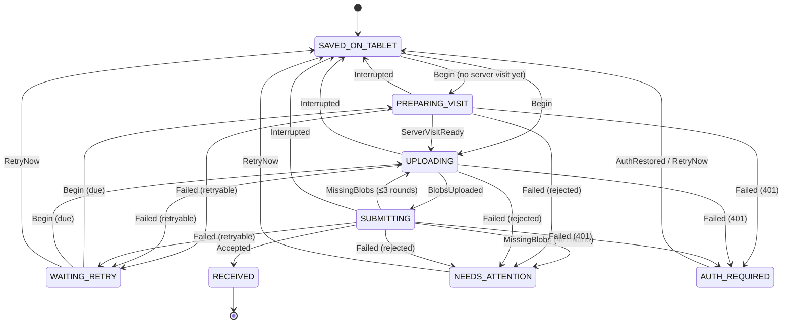

# Sync design: freeze, outbox state machine and delivery status

Goal: a completed visit is never lost and never duplicated, whatever the network does, and the doctor
can call the next patient immediately.

## 1. Completion is local and durable

1. **Lock** (on tap, milliseconds): the visit moves `DRAFT → COMPLETING`; `completedAt` and a new
   `bundleId` (UUID) are persisted. Editing is disabled from here on.
2. **Freeze** (background, ~1–2 s): for each document with ink → `samford-ink/1` JSON → re-parse →
   render 1500×2121 PNG pages → PDF of those pixels → SHA-256 for each → written as immutable blobs
   (`files/blobs/<sha>`, temp file + fsync + rename). Empty documents are marked `EMPTY` and not sent.
3. In **one Room transaction**: documents become `FROZEN` with their page/PDF/ink hashes, the
   completion request body is stored verbatim as the outbox payload, blob references are recorded,
   and the visit becomes `COMPLETED`. Then the SyncWorker is kicked.

A crash or reboot between 1 and 3 leaves the visit in `COMPLETING`; on next start
`Freezer.resumeInterrupted()` re-runs the freeze with the same persisted `completedAt` and
`bundleId`, producing byte-identical files and exactly one outbox entry (tested).

## 2. Outbox state machine

- The transition function (`OutboxStateMachine.transition`) is pure; invalid events throw. `RECEIVED`
  is terminal, so a received bundle can never be sent again.
- Backoff for retryable failures: 30 s, 1 min, 2 min … capped at 30 min; `Retry-After` (429) is
  honoured when longer.
- Only one sync run happens at a time (unique WorkManager work + a mutex). Any bundle found in an
  active state at the start of a run was interrupted by process death and is restarted (safe).
- UI wording: *Saved on tablet* → *Uploading* → *Received by hospital*; *Will retry automatically*;
  *Sign in to the hospital server to upload*; *Needs attention* with the server's plain-language
  message and **Retry now**. Notifications never contain patient names.

## 3. Idempotency (no duplicates)

- **Blobs** are content-addressed: `PUT /blobs/{sha256}`; the server verifies hash, size and type;
  repeating a PUT is harmless.
- **Completion**: `POST /doctor/visits/{visitId}/complete` with `Idempotency-Key = bundleId` and the
  byte-identical stored body. If the reply is lost, the retry returns the original response
  (`Idempotent-Replayed: true`). Tested with a fake that drops the reply after committing, and against
  the real backend.
- **409 MISSING_BLOBS**: the listed hashes are marked not uploaded, re-uploaded, and the same request is
  replayed (bounded to 3 rounds).
- **Offline demo or offline-started visits**: `PREPARING_VISIT` registers the synthetic patient
  (`POST /doctor/walk-ins`, key `walkin-{localVisitId}`) and/or starts the visit
  (`POST /doctor/queue/{id}/start` with `identityConfirmed`, key `start-{localVisitId}`), both
  idempotent, before completing.
- **Addenda**: `POST /doctor/documents/{documentId}/addenda` with `Idempotency-Key = clientAddendumId`,
  `baseVersion` = the latest version the doctor saw; an addendum waits until its original document has
  a server id. Version N+1 lists every earlier page hash unchanged plus the new pages.
- **401** of any kind → `AUTH_REQUIRED`; bundles are kept until the doctor signs in again
  (`SessionRepository.reconnect`), then resume. Sign-out never deletes the outbox.

## 4. Delivery status and events

After `RECEIVED`, the tablet records per-recipient rows (pharmacy, each routed lab, patient) as
`PENDING` (local only), then polls `GET /doctor/visits/{visitId}/delivery` (while the sync screen is
open, after each sync run, and every 15 minutes via a periodic worker) and the events feed
`GET /doctor/events?cursor=` for hints. States shown: available, viewed, sample collected, result
ready, dispensed / partly / not dispensed, superseded by addendum.

## 5. Routing (contract rules)

- Prescription → pharmacy (+ patient). Investigations → the labs the doctor selected (+ patient).
  Visit summary and Advice/Referral → patient only. Labs only ever receive investigations; pharmacy
  only prescriptions (the server enforces this too).
